<div align="center">

# AuditA

### Sistema de Gestión de Auditorías de Seguridad de la Información

Planificación, ejecución y cierre de auditorías basadas en **ISO/IEC 27002:2022** e **ISO 19011:2018**, con cálculo de cumplimiento, validación de trazabilidad y una bitácora forense inmutable encadenada con **HMAC-SHA256**.


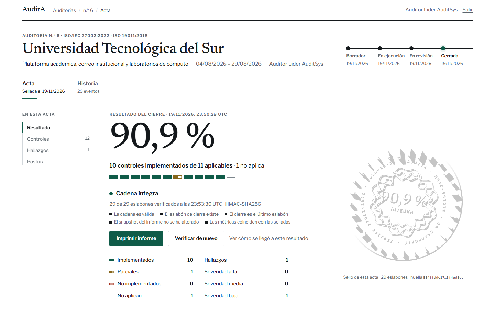

</div>

---

## Tabla de contenido

1. [Descripción](#descripción)
2. [Funcionalidades](#funcionalidades)
3. [Capturas](#capturas)
4. [Stack tecnológico](#stack-tecnológico)
5. [Arquitectura](#arquitectura)
6. [Modelo de datos](#modelo-de-datos)
7. [Seguridad](#seguridad)
8. [Integridad forense (Hash Chain)](#integridad-forense-hash-chain)
9. [Puesta en marcha](#puesta-en-marcha)
10. [Calidad y pruebas](#calidad-y-pruebas)
11. [Estructura del repositorio](#estructura-del-repositorio)
12. [API](#api)
13. [Documentación](#documentación)

---

## Descripción

**AuditA** digitaliza el ciclo completo de una auditoría de seguridad de la información:

```
Planificación  →  Alcance  →  Ejecución  →  Revisión  →  Cierre e informe
  (Borrador)       (10–15       (evaluación,    (trazabilidad)   (acta sellada,
                  controles)    evidencias,                       informe A4,
                                hallazgos)                        verificación)
```

El auditor selecciona entre 10 y 15 controles del catálogo ISO/IEC 27002:2022, evalúa cada uno, lo respalda con evidencias y documenta los hallazgos con la estructura de ISO 19011:2018 (condición, criterio, causa y efecto), cada uno con su recomendación. Antes del cierre, el sistema comprueba que cada control tenga su traza completa. Al cerrar, genera un informe con una huella criptográfica que permite demostrar que nada se alteró después.

**Para quién:** equipos de auditoría interna, consultoras de ciberseguridad y oficiales de seguridad de la información (CISO) que necesitan evidencia verificable del trabajo de auditoría.

## Funcionalidades

| Código | Requisito | Implementación |
|---|---|---|
| **RF01** | Crear auditorías (organización, alcance, periodo) | Validación de campos y de fechas en cliente, API y base de datos |
| **RF02** | Definir el alcance normativo | Entre 10 y 15 controles distintos del catálogo ISO/IEC 27002:2022 |
| **RF03** | Evaluar controles | Implementado, Parcial, No implementado o No aplica; observaciones y justificación obligatorias según el estado |
| **RF04** | Registrar evidencias | Fuente (documental, entrevista u observación técnica), fecha, referencia y checksum SHA-256 |
| **RF05** | Documentar hallazgos según ISO 19011 | Condición, criterio (autocompletado desde el control), causa, efecto y severidad |
| **RF06** | Registrar recomendaciones | Prioridad y plazo estimado, vinculadas a cada hallazgo |
| **RF07** | Calcular el cumplimiento | `ROUND(100 × implementados / aplicables, 1)`, calculado en SQL |
| **RF08** | Cerrar y generar el informe | Snapshot sellado, informe A4 imprimible y huella de integridad |
| **RF09** | Panel de métricas | Cumplimiento, distribución por estado, hallazgos por severidad y postura por atributo |
| **RNF05** | Trazabilidad pre-cierre | Bloquea el cierre si falta evidencia, hallazgo o recomendación |
| **CP-13** | Inmutabilidad | Una auditoría cerrada es de solo lectura (403), también para el administrador |

## Capturas

Las 27 capturas, organizadas por requisito, están en **[docs/EVIDENCIAS.md](docs/EVIDENCIAS.md)**.

| Listado de auditorías | Panel de métricas |
|---|---|
| 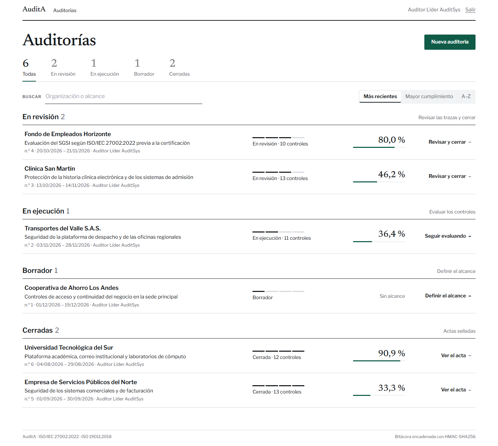 | 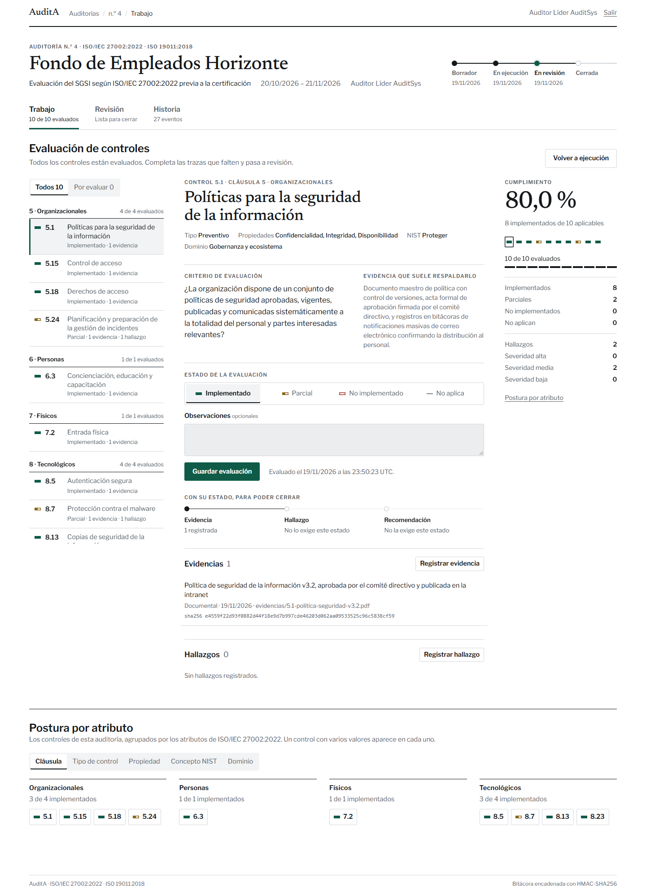 |
| **Selección de controles (RF02)** | **Evaluación de controles (RF03)** |
| 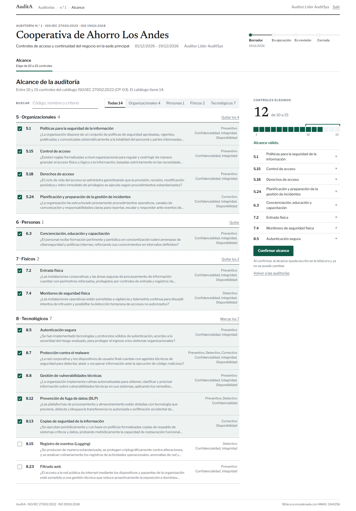 | 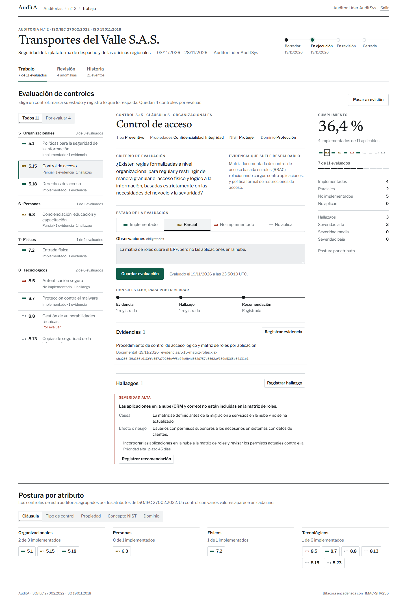 |
| **Registro de evidencia (RF04)** | **Hallazgo ISO 19011 (RF05)** |
| 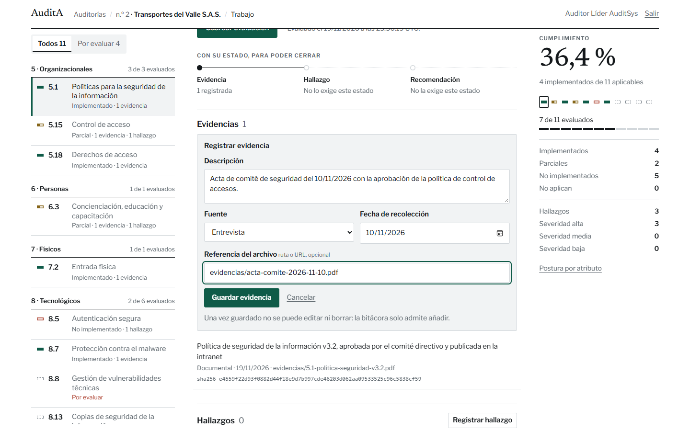 | 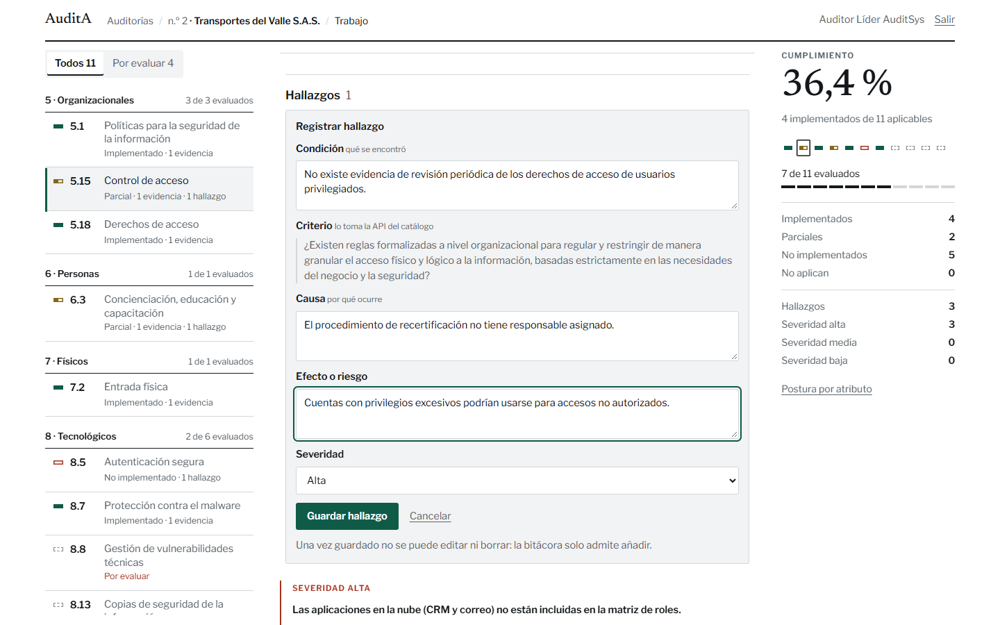 |
| **Revisión de trazabilidad (RNF05)** | **Informe generado (RF08)** |
| 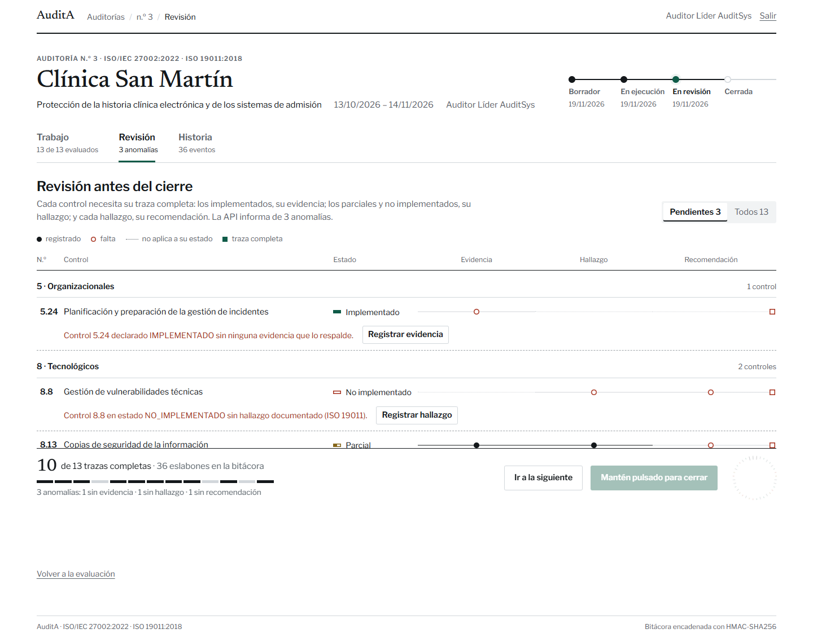 | 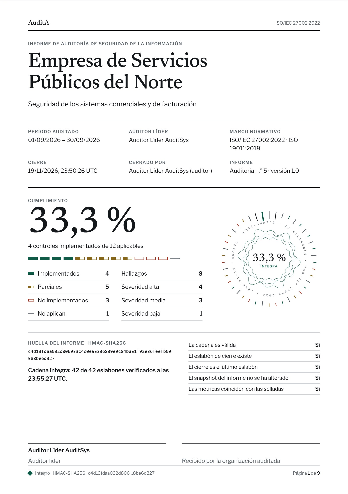 |

## Stack tecnológico

| Capa | Tecnología | Uso |
|---|---|---|
| **Frontend** | React 18, TypeScript, Vite 6 | SPA |
| | React Router 6, TanStack Query 5 | Navegación y caché de datos del servidor |
| | Tailwind 3 y CSS con tokens | Sistema visual con tema claro y oscuro |
| | GSAP, anime.js, Motion, three.js | Movimiento y sello en relieve (carga diferida) |
| | Vitest | Pruebas unitarias |
| **Backend** | Node.js 20+, TypeScript (strict), Express 5 | API REST |
| | Zod 4 | Validación de entrada y de configuración |
| | jsonwebtoken (HS256) y bcryptjs | Autenticación y contraseñas |
| | Helmet, CORS y rate limiting propio | Seguridad HTTP |
| | `node:crypto` | SHA-256, HMAC-SHA256 y comparación en tiempo constante |
| **Datos** | PostgreSQL 16 (`pg`) | Constraints, triggers de inmutabilidad y advisory locks |
| **Infraestructura** | Docker Compose | Base de datos local reproducible |
| **Calidad** | Suite QA HTTP (CP-01 a CP-13) y Vitest | 74 verificaciones de punta a punta y 29 pruebas unitarias |

## Arquitectura

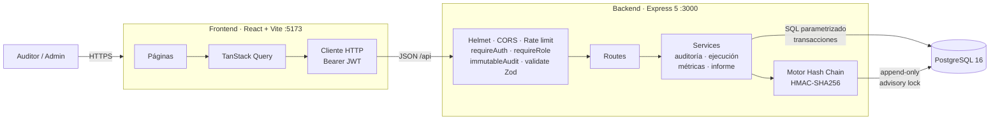

**Principios de diseño**

- **Capas:** rutas, middlewares de seguridad, servicios y acceso a datos. Las rutas no contienen lógica de negocio.
- **Defensa en profundidad:** cada regla se valida en el cliente (para la experiencia de uso), en la API con Zod y en PostgreSQL con `CHECK`, `UNIQUE` y triggers.
- **Atomicidad:** cada cambio de negocio y su evento de bitácora se escriben en la misma transacción. Si uno falla, no queda ninguno.
- **Fuente única de verdad:** la API calcula el cumplimiento y la trazabilidad; el frontend solo los muestra.
- **Concurrencia segura:** las mutaciones bloquean la fila de la auditoría (`FOR SHARE` / `FOR UPDATE`) y un `pg_advisory_xact_lock` serializa la cadena, de modo que no puede bifurcarse ni colarse un cambio durante el cierre.

**Máquina de estados**

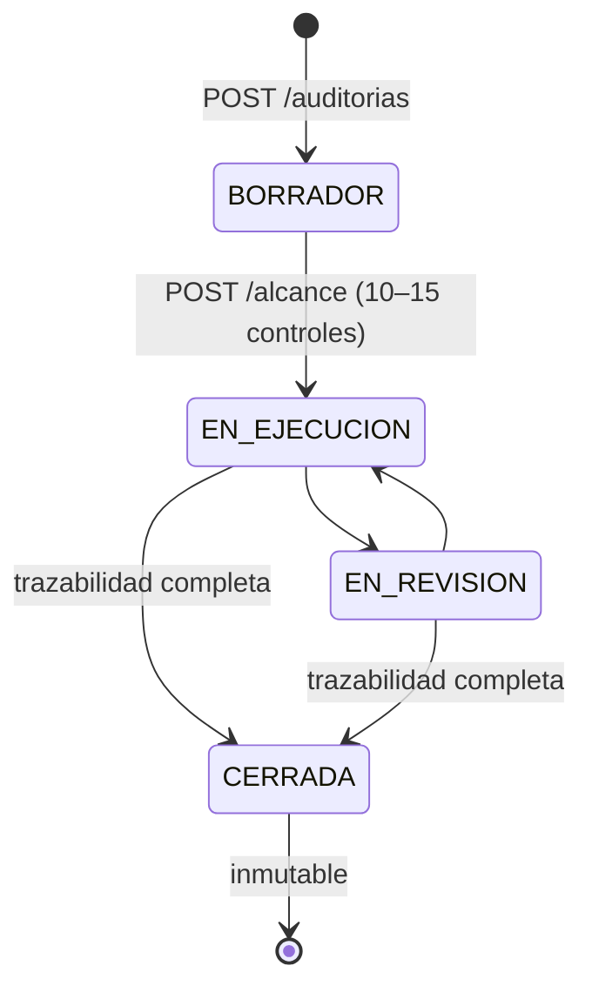

## Modelo de datos

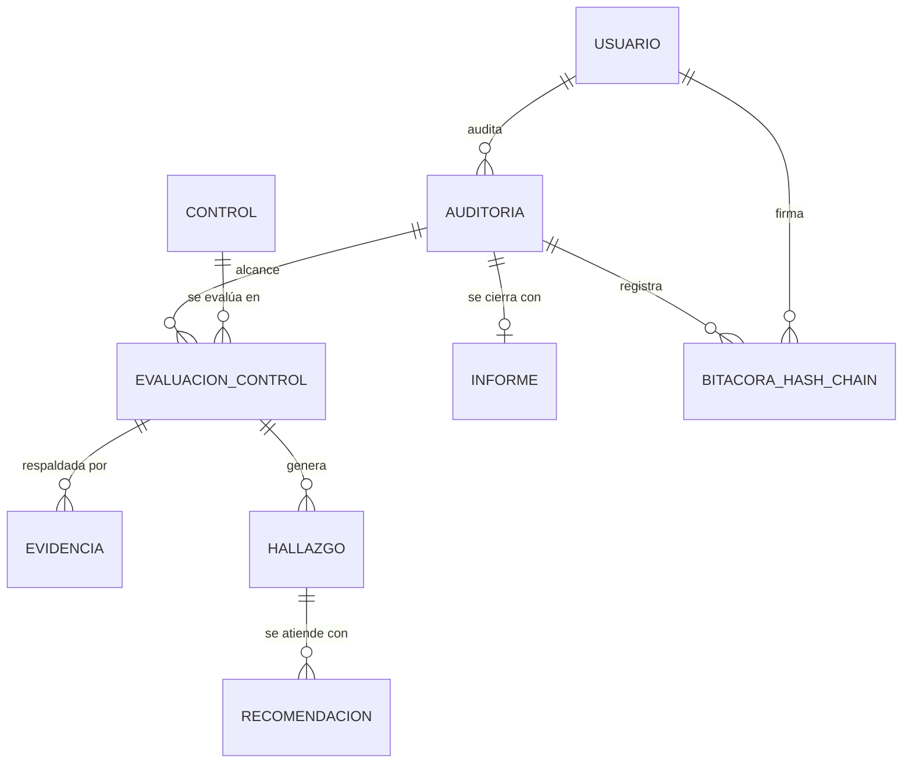

Nueve tablas con sus restricciones nativas, definidas en [`backend/sql/init_auditsys.sql`](backend/sql/init_auditsys.sql), que incluye además el catálogo de 14 controles ISO/IEC 27002:2022.

## Seguridad

Controles alineados con el **OWASP Top 10** y el **OWASP API Security Top 10**:

| Riesgo | Control implementado |
|---|---|
| A01 Control de acceso roto / BOLA | RBAC (`admin` / `auditor`). El auditor solo accede a sus auditorías; un recurso ajeno responde 404 para no revelar su existencia |
| A02 Fallos criptográficos | bcrypt (coste 12, 12 a 72 bytes con complejidad); JWT con algoritmo fijado (rechaza `alg: none`); HMAC con clave separada de la del JWT |
| A03 Inyección | Consultas siempre parametrizadas y validación Zod que descarta los campos no declarados |
| A04 Diseño inseguro | Máquina de estados, validación de cierre e inmutabilidad en base de datos |
| A05 Configuración insegura | Helmet con CSP `default-src 'none'`, CORS con lista blanca, `no-store` y validación de variables de entorno al arrancar |
| A07 Fallos de autenticación | Rate limit en login, misma respuesta y mismo tiempo exista o no el usuario, y rol leído de la base en cada petición |
| A09 Registro y monitoreo | Bitácora forense append-only y verificable criptográficamente |

## Integridad forense (Hash Chain)

Cada auditoría tiene su propia cadena de eventos:

```
hash_n = HMAC-SHA256( ORG_HMAC_SECRET,
                      canonical({ v, id_auditoria, id_usuario, tipo_evento,
                                  timestamp_utc, hash_{n-1}, payload_canonico }) )
```

- **Encadenamiento:** el primer eslabón parte de un hash génesis de 64 ceros. Cambiar cualquier evento rompe todos los posteriores.
- **Con clave:** sin `ORG_HMAC_SECRET` no se puede recalcular una cadena válida, ni siquiera con acceso de escritura a la base.
- **Inmutable:** los triggers de PostgreSQL bloquean `UPDATE`, `DELETE` y `TRUNCATE` sobre la bitácora.
- **Anclada al informe:** el eslabón `CIERRE_INFORME` sella el hash del snapshot y `informe.hash_integridad` es el hash de ese eslabón. La verificación comprueba cinco condiciones: la cadena es válida, el eslabón de cierre existe, es el último, el snapshot no cambió y las métricas coinciden con las selladas.

Verificación desde la línea de comandos: `npm run chain:verify -- <id_auditoria>`.

## Puesta en marcha

**Requisitos:** Node.js 20 o superior y Docker Desktop.

```bash
git clone https://github.com/JeanCarlos14301/auditoria-sistemas.git
cd auditoria-sistemas

# 1. Backend + base de datos
cd backend
npm install
cp .env.example .env        # valores de desarrollo listos para usar
npm run db:up               # PostgreSQL 16 en Docker (esquema + 14 controles)
npm run dev                 # API en http://localhost:3000/api

# 2. Datos de ejemplo (en otra terminal, con la API en marcha)
npm run demo:seed           # 6 auditorías, una en cada etapa del flujo

# 3. Frontend
cd ../frontend
npm install
npm run dev                 # http://localhost:5173
```

**Usuarios de desarrollo:** `admin@auditsys.co` y `auditor@auditsys.co`. Sus contraseñas están en `backend/.env` (`SEED_ADMIN_PASSWORD` y `SEED_AUDITOR_PASSWORD`).

### Despliegue en la nube

Todo el sistema se despliega en **Vercel**: el frontend como sitio estático, la API Express como Vercel Function y PostgreSQL persistente de Neon, creado desde la pestaña *Storage* de Vercel. La guía paso a paso, con la alternativa Neon + Render + Vercel, está en **[docs/DESPLIEGUE.md](docs/DESPLIEGUE.md)**.

> **Producción:** use secretos propios para `JWT_SECRET` y `ORG_HMAC_SECRET`, con `NODE_ENV=production` (desactiva los usuarios de desarrollo) y `TRUST_PROXY=1` detrás de un proxy. `ORG_HMAC_SECRET` no debe cambiarse una vez existan auditorías: invalidaría todas las cadenas.

## Calidad y pruebas

| Suite | Comando | Cobertura |
|---|---|---|
| QA de punta a punta | `cd backend && npm run test:qa` | 74 verificaciones HTTP reales: CP-01 a CP-09 y CP-13, con autenticación, RBAC, inmutabilidad e integridad |
| Unitarias del frontend | `cd frontend && npm test` | 29 pruebas: trazas, sello, historia y paginación del informe |
| Tipos | `npm run typecheck` (en cada proyecto) | TypeScript en modo estricto |

| Caso | Qué se verifica |
|---|---|
| CP-01 | La auditoría nace en estado `BORRADOR` |
| CP-02 | Campos obligatorios y orden de las fechas → 400 |
| CP-03 | Alcance de 9 o de 16 controles → 400; con 13 pasa a `EN_EJECUCION` |
| CP-04 | Parcial o no implementado sin observaciones → 400 |
| CP-05 | No aplicable sin justificación → 400 |
| CP-06 | Control implementado sin evidencia → cierre bloqueado (422) |
| CP-08 | Hallazgo sin recomendación → cierre bloqueado (422) |
| CP-09 | 4 implementados, 5 parciales, 3 no implementados y 1 no aplicable → **33,3 %** |
| CP-13 | Un auditor no puede crear controles (403); auditoría cerrada inmutable (403); integridad verificada |

## Estructura del repositorio

```
auditoria-sistemas/
├── backend/                  API REST
│   ├── sql/                  DDL, triggers y catálogo ISO/IEC 27002:2022
│   ├── src/
│   │   ├── config/           Validación de entorno
│   │   ├── db/               Pool, transacciones y seeder
│   │   ├── crypto/           JSON canónico, hashing y Hash Chain
│   │   ├── auth/             JWT y contraseñas
│   │   ├── middlewares/      Seguridad, RBAC, inmutabilidad, validación y errores
│   │   ├── schemas/          Esquemas Zod
│   │   ├── services/         Lógica de negocio
│   │   ├── routes/           Endpoints
│   │   └── scripts/          QA, demo, verificación forense y administración
│   ├── docker-compose.yml
│   └── API.md                Contrato de la API
├── frontend/                 SPA React
│   └── src/
│       ├── api/              Tipos del contrato, cliente HTTP y consultas
│       ├── auth/             Sesión y rutas privadas
│       ├── pages/            Pantallas
│       ├── components/       Componentes y formularios
│       ├── lib/              Lógica pura (con pruebas)
│       ├── motion/           Animación
│       └── styles/           Tokens y estilos
└── docs/
    ├── DESPLIEGUE.md         Guía de despliegue en Vercel
    ├── EVIDENCIAS.md         Capturas por requisito
    └── capturas/             Capturas del sistema
```

## API

API REST JSON en `/api`, autenticada con `Authorization: Bearer <token>`.

| Recurso | Endpoints |
|---|---|
| Autenticación | `POST /auth/login` · `GET /auth/me` · `GET`/`POST /auth/usuarios` (admin) |
| Catálogo | `GET /controles` · `POST /controles` (admin) |
| Auditorías | `GET`/`POST /auditorias` · `GET /auditorias/:id` · `POST /:id/alcance` · `PATCH /:id/estado` |
| Análisis | `GET /:id/metricas` · `GET /:id/trazabilidad` · `GET /:id/informe` · `GET /:id/verificar-integridad` |
| Ejecución | `PATCH /evaluaciones/:id` · `POST /evaluaciones/:id/evidencias` · `POST /evaluaciones/:id/hallazgos` · `POST /hallazgos/:id/recomendaciones` |

El contrato completo, con tipos, ejemplos, errores y reglas, está en **[backend/API.md](backend/API.md)**.

## Documentación

| Documento | Contenido |
|---|---|
| [backend/README.md](backend/README.md) | Instalación, variables de entorno, scripts, arquitectura y reglas de negocio del backend |
| [backend/API.md](backend/API.md) | Contrato de la API para el frontend |
| [frontend/README.md](frontend/README.md) | Pantallas, reglas de interfaz, dirección de arte y movimiento |
| [docs/EVIDENCIAS.md](docs/EVIDENCIAS.md) | Capturas del sistema organizadas por requisito |
| [docs/DESPLIEGUE.md](docs/DESPLIEGUE.md) | Despliegue en Vercel (API, frontend y PostgreSQL) paso a paso |

---

<div align="center">

**AuditA** · ISO/IEC 27002:2022 · ISO 19011:2018 · Bitácora encadenada con HMAC-SHA256

Proyecto académico · Uso privado (UNLICENSED)

</div>
